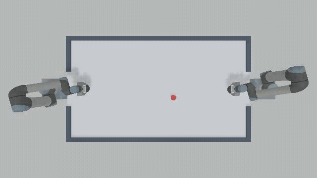
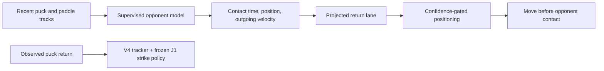

# RallySight

**Supervised Opponent-Aware Positioning for Robot Air Hockey**

[中文介绍](README.zh-CN.md) · [Watch the demo](demos/supervised-anticipation.mp4) · [Research protocol](docs/research.md) · [Evidence](evidence/metrics.json)

After sending the puck away, RallySight predicts when the opponent will strike and where the return will cross our side. The robot moves toward that lane before contact. Once the return is observed, V4 tracks the incoming puck and the frozen J1 policy handles the strike.

| Same serve · seed 4100 · 12 s | Effective alternating returns | Longest active streak | Footage |
|---|---:|---:|---|
| J1 reference | 12 | 12 | [MP4](demos/j1-reference.mp4) |
| Framewise anticipation | 16 | 16 | [MP4](demos/framewise-anticipation.mp4) |
| **Confidence-gated anticipation** | **15** | **9** | [MP4](demos/supervised-anticipation.mp4) |

On this serve, confidence gating reduced the largest adjacent **positioning target** jump from **86.61 cm to 4.75 cm**, and the left paddle's mean absolute lateral speed before opponent contact fell from **3.03 to 0.37 m/s**. The gated version recorded 15 effective returns versus 16, with a shorter uninterrupted streak. The cover is concept art. The clips are simulation recordings.

## How it works

A small GRU estimates the opponent's next impact from eight frames of history. A rail-reflection model projects the outgoing shot to a receiving lane. The positioning controller commits when two successive predictions agree and holds the confirmed lane through brief prediction gaps. The displayed method uses supervised learning and requires no PPO.

## Research value

- **Isolate anticipation.** Freeze the striking policy and vary only the receiver's pre-contact positioning. This makes the value of reading the opponent before impact testable.
- **Expose the prediction–control trade-off.** Compare total returns, uninterrupted streaks, and lateral motion separately. A predictive advantage can coexist with unstable positioning.
- **Separate sensing from control.** Simulator poses and contact signals make it possible to diagnose the controller first. A separate camera-based experiment can then measure sensing delay and transfer.

Across three 12-second **diagnostic** seeds, J1, framewise anticipation, and gated anticipation recorded **30, 28, and 37** total effective alternating returns. These scenarios were used during development and do not establish generalization. The speed-relaxed setting is for simulation. See [the full table, settings, and metric definitions](docs/research.md).

## Explore

- [Opponent model and positioning code](src/opponent_anticipation.py)
- [Trace-level evidence](evidence/) and [computed metrics](evidence/metrics.json)
- Run `python scripts/summarize.py` to recompute the metrics from the included traces.

The [Buaa-WAM project](https://github.com/xy211699-arch/Buaa-WAM) provides the simulator and J1 execution stack. RallySight contains the showcase, core method source, and trace-level analysis. See [provenance and rollout dependencies](docs/research.md). Code under the [MIT license](LICENSE).
