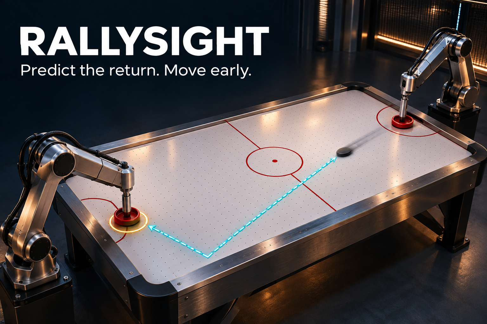

# RallySight

**Robot air hockey, with a head start on the next return.**

RallySight is a robot air hockey project. Two industrial robot arms play across the same simulated table, taking turns sending a puck back to one another. The aim is to sustain a rally. That gives us a precise question to work on: **while the puck is still on the other side of the table, can our robot read the opponent's movement and start getting into position for the next shot?**

<p align="center">
  <a href="#watch-a-rally">Watch a rally</a> ·
  <a href="#how-the-project-evolved">Research journey</a> ·
  <a href="#check-the-evidence">Check the evidence</a> ·
  <a href="README.zh-CN.md">中文</a>
</p>

<p align="center">
  
</p>

## Watch a rally

Watch the left paddle **after it sends the puck away**. During that interval, RallySight estimates where the opponent's return will cross the table and begins moving toward that lane. The prediction is updated as the opponent moves. Once the puck has been struck, the controller again tracks the observed puck and uses the same striking policy as the reference.

<p align="center">
  <a href="demos/anticipation-with-confirmation.mp4"></a>
  <br><sub>Simulation footage. Select the preview for the full 12-second recording.</sub>
</p>

<table>
  <thead>
    <tr><th>How the robot chooses where to wait</th><th align="right">Effective returns</th><th align="right">Longest active streak</th><th>Replay</th></tr>
  </thead>
  <tbody>
    <tr><td>Follow the current puck trajectory</td><td align="right">12</td><td align="right">12</td><td><a href="demos/current-puck-trajectory.mp4">Watch</a></td></tr>
    <tr><td>Predict the opponent’s return every frame</td><td align="right">16</td><td align="right">16</td><td><a href="demos/anticipation-each-frame.mp4">Watch</a></td></tr>
    <tr><td><strong>Predict the return and confirm the lane before moving</strong></td><td align="right"><strong>15</strong></td><td align="right">9</td><td><a href="demos/anticipation-with-confirmation.mp4">Watch</a></td></tr>
  </tbody>
</table>

*All three recordings use the same serve, seed 4100, and the same 12-second budget. An active streak ends when the sequence of alternating, forward strikes breaks.*

## How the project evolved

### September 2026 · A table we could replay

The work began with a SAPIEN/PhysX simulation of an air hockey table, two UR5 arms, an overhead camera, and a puck that could slide, rebound, and collide with both paddles. Contact was measured from the physics engine. That detail matters because a paddle can pass very close to the puck and still miss. Serve position, direction, speed, spin, and friction could vary between seeds, while candidate actions within a seed shared the same initial conditions.

The first demonstrations came from a planning expert. It saved the current scene, tried contact times and speeds with physics rollouts, checked reachability, and restored the scene before executing the chosen strike. The recorder captured only that execution. A handoff to the second arm gave us synchronized image, puck, joint, and contact records for a return in each direction. These demonstrations taught the system what a feasible strike looks like and gave us reliable timestamps for training. The planner's searches were kept off the recorded timeline.

### October 2026 · From predicting a puck to striking it

The first learned model located the puck in RGB images and predicted where it would travel. The next step was to make that forecast useful to a robot. We trained an imitation policy to propose a contact delay, target, and striking speed, then translated those intentions into joint commands. We also trained an auxiliary predictor of what would happen after a proposed hit. That helped some model initializations, but the advantage did not hold across all the runs, so the future-prediction loss remained an experimental choice.

When the strike was late, we initially had several possible explanations: the puck forecast, the time proposed by the policy, and the motion needed to get to the strike position. Controlled rollouts separated those effects. They showed why a plausible action can fail when the controller starts from the wrong place or cannot reach the preparation point on time.

### Early November · Learning actions from language and state

We tested a separate idea: a compact language-model backbone that outputs numerical actions from structured game observations. It learned some of the action conventions offline, but the closed-loop evaluation exposed a gap between producing a valid-looking command and returning the puck. Two of the original incoming-ball scenarios produced no returns in the reported prototype. We set that branch aside for the rally system and returned to the visual striking policy with a controller we could instrument frame by frame.

### Mid-November · Keeping the rally alive

The simulation became a continuous exchange. Both sides refreshed their observations, made decisions, struck, and recovered on one uninterrupted physics timeline. There was no expert takeover between shots. A lightweight reinforcement-learning trial from scratch did not produce reliable active returns. Later, a small PPO residual policy improved some development cases, but on four separate paired scenarios it matched the frozen reference at **5.5 active returns per run on average**.

Another failure was visible immediately in the footage. The puck could travel toward the rail while the paddle stopped short. The logs showed a preparation range of ±0.28 m, even though striking allowed ±0.48 m. Widening the preparation range turned one diagnostic run from **3 to 10 consecutive active hits** with the striking model held fixed. That result redirected our attention toward what the robot does **between** its strikes.

### Late November · Learning to read the other end of the table

The earlier puck model followed a shot already in motion. We added a supervised opponent model to estimate the next contact time, the impact position, and the velocity of the puck after that impact. It learns from expert and autonomous simulation traces. At runtime, a short history of the puck and both paddles is enough to produce a predicted receiving lane, including an approximate side-rail reflection.

A PPO experiment adjusted the predicted ready position using rally rewards. Across nine paired tests in that earlier setup, supervised positioning averaged 5.44 effective returns and the PPO adjustment averaged 4.67. That result led us to keep the learned opponent forecast and work on how the controller responds to it. The clips on this page use a different, speed-relaxed diagnostic setup.

The first implementation moved toward a new lane on every prediction. It produced the 16-hit rally above, but in that same run successive lateral targets sometimes jumped **86.61 cm** in one frame. A later implementation waits for two consistent predictions, keeps the last confirmed target through brief disagreements, and bounds how fast that target can move. The average absolute lateral speed of the left paddle before contact fell from **3.03 to 0.37 m/s** in the paired demonstration. This is the version shown in the preview. It uses supervised learning and a positioning rule, without a PPO policy.

## When is an early prediction worth acting on?

A prediction can be early and still be a poor instruction for the robot. In the same rally, confirming the lane cut the largest target jump to **4.75 cm** and preserved **15 effective returns**, while the longest uninterrupted streak fell from **16 to 9**. Across the three diagnostic serves, following the puck, updating on every prediction, and confirming before moving gave **30, 28, and 37 effective returns** respectively. The three serves were used during development. Neither the best streak nor the aggregate establishes which controller will play better against an unseen opponent.

This is what makes the table a useful research instrument. The striking policy can stay fixed while we vary when and how the robot acts on an opponent forecast. We can then measure anticipation through readiness before contact, return quality, and unnecessary motion, instead of judging it by the longest clip. The next experiments are independent evaluation against different opponents, camera-based paddle tracking, and measurement under hardware-feasible speeds. The present demonstration uses simulated positions and contact signals.

## Check the evidence

Recompute the published table and motion statistics with Python alone:

```bash
git clone https://github.com/LiYu267/RallySight.git
cd RallySight
python scripts/summarize.py
```

| Included here | Where to look |
|---|---|
| Model, supervision targets, and positioning rules | [Source](src/opponent_anticipation.py) |
| Nine paired rollouts with puck and paddle traces | [Trace files](evidence/) |
| Metric definitions, parameters, and evaluation limits | [Research protocol](docs/research.md) |
| Original simulator, assets, and striking stack | [Buaa-WAM](https://github.com/xy211699-arch/Buaa-WAM) |

The trace audit runs without the simulator. Full simulation rollouts also require the original environment and trained striking checkpoints. The poster is concept art. All replay footage comes from simulation. The code is released under the [MIT license](LICENSE).
